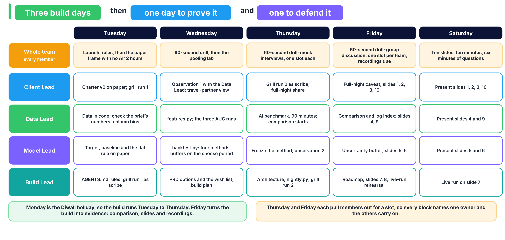

# How many rooms can each hotel oversell tonight?

Build 2, Week 6. Your team is a revenue-science squad at RateGain, and a two-hotel group in Portugal has asked you one question, in `BRIEF.md`. Everything your team builds, decides and records lives in this repository. The last commit before Friday's deadline is the one that is graded.



## What do we open, and when?

| When | Open | Why |
|---|---|---|
| Tuesday, first hour | `BRIEF.md` in full, `docs/ROLES.md` (your row and the disagreement rule), `docs/LADDER.md` (stages 0 to 2), `docs/EVALUATION_CONTRACT.md` | The ask, your role, the stages and the scoring rule |
| Tuesday, paper frame, no AI | `docs/CHARTER.md`, `docs/RFP.md`, `docs/DOMAIN.md` | Ladder stages 0 to 2 |
| Tuesday, data | `notebooks/00_start_here.ipynb`, `docs/COLUMNS.md`, `docs/DECISIONS.md` | Check the brief's numbers and start the column audit |
| Tuesday, grill run 1 | `docs/AI_WORKFLOW.md`, `AGENTS.md` | Agent rules and the first grilling |
| Wednesday | `docs/PRD.md`, `docs/BUILD_PLAN.md`, `src/contract.py` | Options, then the POC method table |
| Thursday | `docs/AI_WORKFLOW.md`, `ai_benchmark/README.md` | The MVP, the AI benchmark and grill run 2 |
| Friday | `docs/COMPARISON.md`, `docs/ROADMAP.md`, `docs/PRESENTATION.md`, `docs/RECORDING.md` | The comparison, the roadmap, the slides and your recording |
| Any time | `docs/RUBRIC.md` | How the 40 marks are given |

## Which two commands must work by Friday?

```bash
python src/backtest.py
python src/nightly.py --from 2017-08-18 --nights 14
```

The first prints every method you tried on the proof period and saves the chosen one to `models/`, which you commit. The second writes the table the revenue manager reads each morning. `pytest -q` checks the client's scoring rule at any time.

## Who owns each artifact, and who has signed it?

A challenger signs by writing the commit hash they checked. An artifact counts as done only once it is signed.

| Artifact | Owner | Challenger | Signed at commit |
|---|---|---|---|
| `docs/CHARTER.md` and `docs/RFP.md` | | | |
| `docs/COLUMNS.md` and `src/features.py` | | | |
| `src/backtest.py` | | | |
| `docs/PRD.md`, `docs/BUILD_PLAN.md` and `src/nightly.py` | | | |
| `docs/COMPARISON.md` | | | |

## Where are our recordings?

| Member | Role | Recording link on the LMS |
|---|---|---|
| | Client Lead | |
| | Data Lead | |
| | Model Lead | |
| | Build Lead | |

## Where does the data come from?

Antonio, N., de Almeida, A. and Nunes, L. (2019). Hotel booking demand datasets. _Data in Brief_, 22, 41 to 49. CC BY 4.0. `src/data.py` downloads it; see `data/README.md`.
