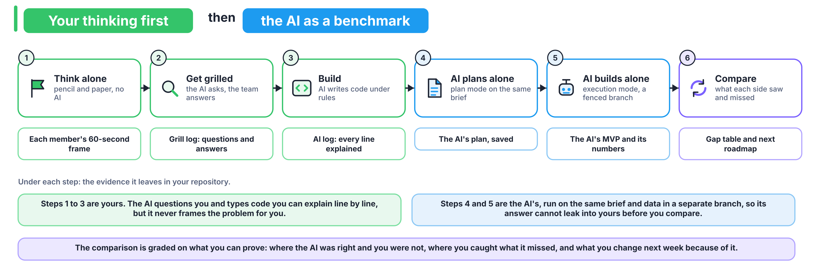

# How do we use AI this week, and how do we prove what it did?



## Which work happens without AI?

- Tuesday's paper frame, ladder stages 0 to 2. Type or photograph charter version 0 into the repository before anyone opens an AI tool.
- Saturday's defence, and any viva.

Everything else may use AI, and every chat is logged. Whoever commits an AI-written line must be able to explain it.

## Which tools can we use?

A free ChatGPT, Claude or Gemini chat is enough for every step below. Claude Code and GitHub Copilot help where you have them; do not assume every member does.

## How do we give a coding agent our rules?

**Who and when:** the Build Lead, on Tuesday, in 15 minutes.

1. Write at least five project rules under the first heading of `AGENTS.md`, each taken from a decision in your charter or `docs/DECISIONS.md`.
2. Append Andrej Karpathy's coding guidelines (collected in `forrestchang/andrej-karpathy-skills`) and copy the file to where each tool looks for it. Run the second line again whenever `AGENTS.md` changes.

```bash
curl -sL https://raw.githubusercontent.com/forrestchang/andrej-karpathy-skills/main/CLAUDE.md >> AGENTS.md
cp AGENTS.md CLAUDE.md && mkdir -p .github && cp AGENTS.md .github/copilot-instructions.md
```

3. In a plain chat, paste `AGENTS.md` as the first message before you ask for code.

The guidelines come down to four principles: think before coding, simplicity first, surgical changes, and goal-driven execution. Capture one screenshot where the agent stated an assumption or pushed back on you, save it in `ai_logs/`, and embed it in `ai_logs/karpathy_effect.md` with one line on what it changed.

## How do we get grilled?

Matt Pocock's `grill-me` skill (repository `mattpocock/skills`) makes the AI interview you about a plan in rounds of numbered questions, each with a recommended answer, until every branch of the plan is settled.

| Tool | How to start it |
|---|---|
| Claude Code | `claude plugin install mattpocock-skills@claude-plugins-official`, then type `/grill-me` |
| Copilot CLI | `copilot plugin marketplace add mattpocock/skills`, then `copilot plugin install mattpocock-skills@mattpocock` |
| Gemini CLI | `gemini skills install https://github.com/mattpocock/skills.git --path skills/productivity`, then the same command with `--path skills/engineering` |
| Any plain chat | Paste [the grilling skill's text](https://raw.githubusercontent.com/mattpocock/skills/main/skills/productivity/grilling/SKILL.md) as the first message, then your document |

| Run | When | Document | Opening line | Log |
|---|---|---|---|---|
| 1 | Tuesday, after the paper frame and the first data pass: 45 minutes, then the edits before the day ends | Charter v0 and the RFP skeleton | "Grill me on this charter until we share an understanding of what is being decided, for whom, from what is known when, and what one wrong call costs in each direction." | `docs/grill_01_charter.md` |
| 2 | Thursday, after the POC: 45 minutes | PRD and build plan | "Grill me on this PRD and build plan until every branch of the design tree is settled." | `docs/grill_02_prd.md` |

Write your own answer before you read the recommended one. Every "yes" is a decision you will defend on Saturday.

Three more skills from the same repository, used only when a question calls for one: `research` when a claim about hotels needs a primary source, `prototype` for throwaway code that answers one question, and `diagnosing-bugs` when the back-test disagrees with a count you made by hand.

## How do we benchmark an AI build against ours?

**Who and when:** the Data Lead, on Thursday, in a box of 90 minutes.

1. Commit everything on `main`, then branch from the repository's first commit, so the AI starts from what you had on Tuesday morning:

```bash
git switch -c ai-benchmark $(git rev-list --max-parents=0 HEAD)
```

2. Switch to plan mode: Shift+Tab in Claude Code until it shows plan mode, the Plan agent in Copilot, or a request for a plan only in a chat. Give this prompt, word for word:

   > You are the vendor's engineering team. Read only BRIEF.md, docs/EVALUATION_CONTRACT.md, src/data.py and src/contract.py. The data is at data/hotels.csv; download nothing else. Produce a plan only, no code: what you will predict, which columns you will use and why, which bookings you will score, how you will split the data, what you will compare against, how you will turn predictions into the number of rooms to oversell each night, and what you will report. Stop and wait for approval.

3. Save the plan as `ai_benchmark/PLAN_AI.md`, then approve it as written. If the AI asks a question, answer only from `BRIEF.md`.
4. Give the execution prompt:

   > Execute the approved plan. Write ai_benchmark/run.py so that `python ai_benchmark/run.py` prints the proof-period results and writes the oversell table for 18 to 31 August 2017. Stop when it runs end to end.

5. Edit nothing the AI wrote, except to fix an environment error such as a missing package. In a plain chat you may paste an error message back and run what the AI returns, but you may not change its logic yourself. The box closes at 90 minutes, whatever state it is in.
6. Save and leave the branch, which is never merged: `git add -A && git commit -m "AI benchmark" && git push -u origin ai-benchmark && git switch main`.

On Friday, `docs/COMPARISON.md` sets the AI build beside yours.

## How do we log every chat?

One file per session in `ai_logs/`, named `YYYYMMDD_role_tool_purpose.md`, for example `20261110_client-lead_claude_grill-charter.md`. Each holds the chat's share link and the pasted text; in VS Code, Copilot's **Chat: Export Chat** command saves it. Then add a row to `ai_logs/INDEX.md`.
