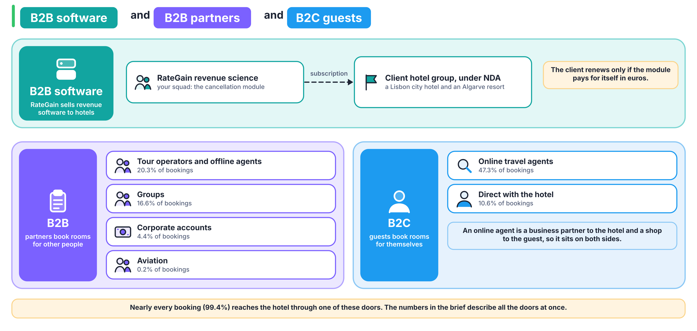

# Which hotel words do we need this week?

These are standard hospitality revenue-management terms. Where the dataset defines a term its own way, the third column says so.

| Term | What it means | How it is counted |
|---|---|---|
| Occupancy | The share of the hotel's rooms that were sold for a night | rooms sold ÷ rooms available |
| ADR (average daily rate) | The average price paid per occupied room night | room revenue ÷ room nights sold; in the data, `adr` is per booking |
| RevPAR | Room revenue per room the hotel could have sold | room revenue ÷ rooms available, which equals occupancy × ADR |
| Lead time | How far ahead the booking was made | arrival date minus booking date, in days (`lead_time`) |
| Length of stay | The nights booked | `stays_in_weekend_nights` + `stays_in_week_nights` |
| Cancellation rate | The share of bookings that never become a stay | cancelled bookings ÷ bookings, for a stated set of bookings and period |
| No-show | A guest who neither cancels nor arrives | counted as a cancellation in `is_canceled` |
| Overbooking | Selling more rooms than exist, expecting some bookings not to arrive | rooms sold minus rooms available |
| Walking a guest | Sending a guest with a confirmed booking to another hotel because the hotel is full | the hotel pays for the other room, the transport and usually a goodwill gesture |
| Allotment or block | Rooms held for a tour operator or a group under contract | unsold rooms go back on sale at an agreed cut-off date |
| OTA | An online travel agency that sells the hotel's rooms to guests for a commission | Booking.com and Expedia are examples |
| Tour operator | A business that packages rooms with flights or tours and sells the package | usually holds allotments |
| GDS | The global distribution system that travel agents and corporate travel desks book through | Amadeus, Sabre and Travelport are examples |
| Market segment and channel | The segment says who the customer is; the channel says how the booking arrived | `market_segment` and `distribution_channel`; a group can arrive through a travel-agent channel |

## Who are the two sides of this business?

- **Business customers (B2B).** Tour operators and offline travel agents, groups, corporate travel desks and airlines buy rooms in volume, often under contract. In the data they appear through `market_segment`, `agent` and `company`.
- **Guests (B2C).** Individual travellers book directly with the hotel or through an online travel agency. An OTA sits on both sides: a business partner to the hotel, a shop to the guest.
- **The software vendor.** RateGain sells revenue software to the hotel group. It is paid by the hotel, so its work has to pay for itself in the hotel's euros.

In `agent` and `company`, an empty value means "booked without one", which is a category of its own and not a missing value.
