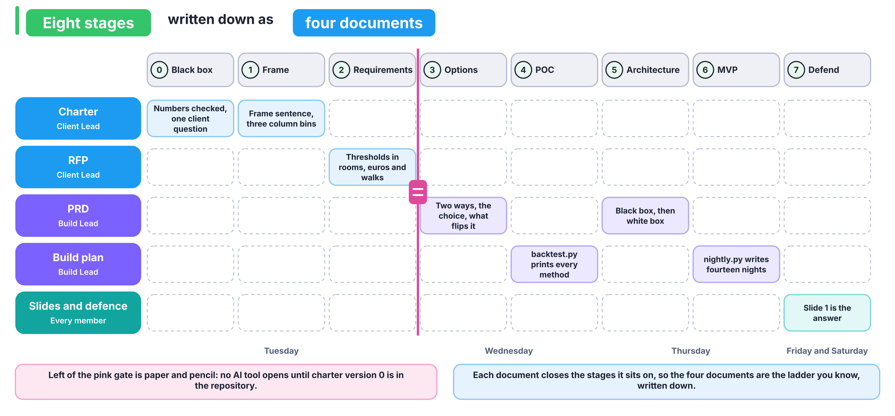
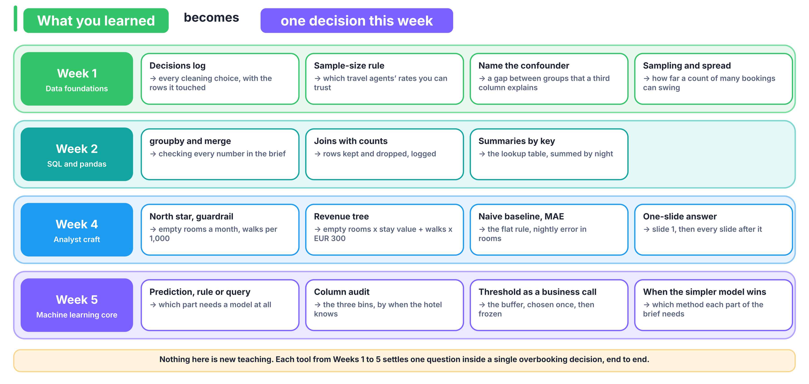

# How do we get from the brief to a number the client acts on?

You already know this ladder: eight stages, from the business as a black box to a defended answer. This week every stage has one question per role and one line that says when the stage is done. The four documents you write (charter, RFP, PRD, build plan) are the ladder written down, so there is no second framework to learn.

Work down the stages in order. When a later stage shows that an earlier answer was wrong, go back, fix the earlier document, and log the change in `docs/DECISIONS.md`.

## Stage 0: What is the business, seen as a black box?

| Role | Asks |
|---|---|
| Client Lead | Who pays RateGain, who at the hotel decides each night, and what does one wrong call cost in each direction? |
| Data Lead | Which of the client's numbers can I check today, and which need a question back to the client? |
| Model Lead | Which number would the revenue manager change tomorrow if we were right? |
| Build Lead | Who uses our output, in which room, and at what point in their day? |

**Done when** the charter's black-box answers are written, every number in the brief has the value you checked beside it, and one question to the client is written down.

## Stage 1: What exactly is being decided?

| Role | Asks |
|---|---|
| Client Lead | What is decided, from what is known when, about which outcome? Is the unit the booking or the night, and why? |
| Data Lead | Which columns exist on the day of booking, which can change before arrival, and which are written after the outcome? |
| Model Lead | Which column is the target, and does every column mean what its name says? |
| Build Lead | What is the smallest table the client could act on each morning? |

**Done when** the frame sentence is in the charter, every column sits in one of three bins in `docs/COLUMNS.md` by when the hotel learns its value, and any bookings that follow different rules from the rest are named, with the number that shows it.

## Stage 2: How good must the answer be, and within which limits?

| Role | Asks |
|---|---|
| Client Lead | How good, in rooms, euros and walks per 1,000, and on which period? |
| Data Lead | What must the input file look like for a nightly run? |
| Model Lead | What is the proof rule (train, choose, prove), and which baseline must we beat? |
| Build Lead | Which limits bind: inputs, run time, explanation, guest data? |

**Done when** the RFP fits on one or two pages, with acceptance thresholds in business units and the three periods named.

## Stage 3: Which ways could we decide, and which do we choose?

| Role | Asks |
|---|---|
| Client Lead | Which two ways could we decide, what does each cost to build and to run, which do we choose, and what would flip the choice? |
| Data Lead | Where does each way get its numbers from? |
| Model Lead | Is a lookup table already a model, and when does a learned model earn its place? |
| Build Lead | Which method would the wish-list item need, and would its output change any number the client acts on? |

**Done when** the PRD's options section names two ways, the choice, the flip condition, and an answer to the wish-list item backed by a number.

## Stage 4 (POC): Does the idea survive a first test?

| Role | Asks |
|---|---|
| Client Lead | Does our way beat the client's flat rule in euros with the ceiling met? |
| Data Lead | Is every column the method uses one the hotel knew on the day of booking? |
| Model Lead | Do the client's flat rule, a lookup table and at least two learned models sit in one table, scored by `src/contract.py` on the same nights? Which choose-period nights set each method's buffer? |
| Build Lead | Can a teammate reproduce that table with one command? |

**Done when** `python src/backtest.py` prints every method on the proof period, with AUC, nightly error in rooms and cost in euros under the ceiling, and the numbers match the slides.

## Stage 5: What does the system look like inside?

| Role | Asks |
|---|---|
| Client Lead | Where does a person overrule the number, and how is that recorded? |
| Data Lead | What flows from the bookings file to the nightly table, box by box? |
| Model Lead | Where is the buffer chosen, and where is it frozen? |
| Build Lead | What would production add that the MVP leaves out? |

**Done when** the PRD holds the diagram, from black box to white box, with the production additions listed.

## Stage 6 (MVP): Could the revenue manager use it tomorrow?

| Role | Asks |
|---|---|
| Client Lead | Would the revenue manager trust this table tomorrow morning, and what would they ask first? |
| Data Lead | Does the nightly run read only the bookings file and the saved model? |
| Model Lead | Is the buffer the one chosen on the choose period, untouched? |
| Build Lead | Does one command produce the table for the next fourteen nights? |

**Done when** `python src/nightly.py --from 2017-08-18 --nights 14` writes the nightly table using only columns the hotel knew at booking, and the challenger has signed it in the README.

## Stage 7: Can every one of us defend every number?

| Role | Asks |
|---|---|
| Client Lead | What is the one sentence the client acts on? |
| Data Lead | Which screenshot proves each number? |
| Model Lead | Which method won under which measure, and why do the rankings disagree? |
| Build Lead | Which gaps did the AI build expose in ours, and which mistakes did it make? |

**Done when** every member can defend every number, and slide 1 is the answer.

## What do we do when we are stuck?

1. After 25 minutes without progress, the owner writes a stuck note in your team's GitHub Discussion thread, in three lines: what we tried, what we expected, what we saw.
2. A TA answers within 30 minutes with a first clue, which is a question.
3. After another 25 minutes you may ask for a second clue, which points at the evidence. After a further 25 minutes you may ask for a third, which shows the computation.
4. Clues carry no penalty. They are logged, and if a clue changed a decision, you say so on the slide where that decision appears.

## What is the 60-second card?

Every build morning starts with a 10-minute drill on a different business. You get one card and 60 seconds, alone, to answer five questions. This is the shape an interviewer expects when they say "what would you measure?"

1. Who pays, and who decides?
2. What is the one decision?
3. What is the unit of that decision?
4. Which three metrics would you track, ranked? Mark the north star and the guardrail.
5. Rule, lookup table or model, and why?

Run the same five questions on the hotel brief before you open any template.

## Where do Weeks 1 to 5 show up this week?

| Week | What you learned | Where it decides something this week |
|---|---|---|
| 1 | Profiling and cleaning with a decisions log | Every cleaning choice, its reason and the rows it touched, in `docs/DECISIONS.md` |
| 1 | The sample-size rule | Which travel agents' cancellation rates you can trust |
| 1 | Correlation against causation: name the confounder | A gap between two groups of bookings that a third column explains |
| 1 | Sampling and spread | How much a count of many uncertain bookings swings (Wednesday's pooling lab) |
| 2 | `groupby`, `merge`, joins with before-and-after counts | Checking the brief's numbers, the lookup table, summing by night |
| 4 | North star and guardrail, each with numerator, denominator, window and exclusions | Empty rooms per month, and walks per 1,000 arrivals |
| 4 | The revenue tree | The cost of a night: empty rooms times stay value, plus walks times EUR 300 |
| 4 | Naive baselines, and MAE in business units | The client's flat rule, and nightly error in rooms |
| 4 | The one-slide answer: claim, evidence, caveat, action | Slide 1 and every slide after it |
| 5 | Prediction, rule or query | Which part of the problem needs a model, which a rule and which a `groupby` |
| 5 | The prediction-time question and the column audit | The three bins in `docs/COLUMNS.md` |
| 5 | Train, validation, test, and the baseline | Train, choose, prove |
| 5 | Threshold selection as a business decision | The buffer, chosen once on the choose period |
| 5 | The error bill in money | Euros and rooms on the proof period |
| 5 | Clustering compared, and when the simpler model wins | Deciding which method each part of the brief needs, simplest first |

Nothing on this page is new teaching. The project asks you to use what you have, on one decision, end to end.
