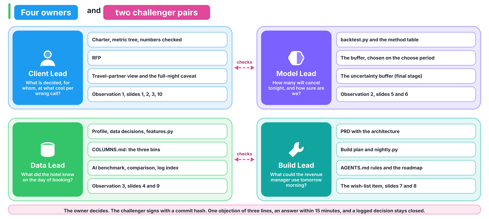

# Who owns what, and how do we disagree without fighting?

Four roles, one owner per artifact. The owner decides on their own artifact, a named challenger checks it, and every member can still explain every number.

## What does each role own?

| Role | Owns these artifacts | Owns this question | Owns this observation from the brief | Challenges |
|---|---|---|---|---|
| Client Lead | `docs/CHARTER.md` with the metric tree and the numbers-checked table, `docs/RFP.md`, the travel-partner view (rate against volume), the full-night caveat, slides 1, 2, 3 and 10 | What is decided, for whom, at what cost per wrong call? | Checking every number in the brief, and observation 1 (with the Data Lead) | Model Lead |
| Data Lead | The profiling notebook, the data decisions in `docs/DECISIONS.md`, `docs/COLUMNS.md`, `src/features.py`, the AI benchmark and `docs/COMPARISON.md`, `ai_logs/INDEX.md`, slides 4 and 9 | What did the hotel know on the day of booking? | Observation 3 | Build Lead |
| Model Lead | `src/backtest.py`, the method table, the buffer chosen on the choose period, the uncertainty buffer (final stage), slides 5 and 6 | How many will cancel tonight, and how sure are we? | Observation 2 | Client Lead |
| Build Lead | `docs/PRD.md` with the architecture diagram, `docs/BUILD_PLAN.md`, `src/nightly.py`, the project rules in `AGENTS.md`, `docs/ROADMAP.md`, slides 7 and 8 | What could the revenue manager use tomorrow morning? | The wish-list item | Data Lead |

The grill logs belong to the owner of the document being grilled: `docs/grill_01_charter.md` to the Client Lead, `docs/grill_02_prd.md` to the Build Lead.

## How does a challenger work?

- The Client Lead and the Model Lead check each other: does the method serve the money, and does the money rule match what the method outputs?
- The Data Lead and the Build Lead check each other: does the MVP read only columns from the first bin, and does the pipeline produce what the MVP reads?
- A challenger signs the partner's artifact in the README table, with the commit hash they checked. An artifact counts as done only once it is signed.

## What happens when we disagree?

1. The owner decides on their own artifact.
2. A challenger may file one written objection of three lines in `docs/DECISIONS.md`: what I object to, why, what I propose.
3. The owner answers in writing within 15 minutes.
4. If it is still open, a frame or money question goes to the Client Lead and a scope or time question goes to the Build Lead. A TA breaks a true tie, and the result is logged.
5. A logged decision is not reopened. New evidence opens a new entry.

## How are roles assigned?

In the first 20 minutes on Tuesday, each member writes a first and a second choice. A first choice nobody else wants is granted. A contested role goes to a coin toss run by a TA. The assignment is logged and does not change after the first hour. The role that worries you is usually the one that teaches you most.

## What changes in the team of three?

There is no Build Lead, so every Build Lead item has a named owner below. The team is excused from the uncertainty buffer, so its final stage is the full-night caveat and the roadmap, and it may hand-draw the architecture diagram. Three recordings, the same rubric.

| Role | Owns, in the team of three | Is challenged by |
|---|---|---|
| Client Lead | Charter, RFP, PRD with the wish-list answer, `docs/grill_01_charter.md` and `docs/grill_02_prd.md`, the travel-partner view, the full-night caveat, slides 1, 2, 3, 8 and 10 | Data Lead |
| Data Lead | Profiling notebook, data decisions, `docs/COLUMNS.md`, `src/features.py`, the project rules in `AGENTS.md` and `ai_logs/karpathy_effect.md`, the AI benchmark, `docs/COMPARISON.md`, `docs/ROADMAP.md`, `ai_logs/INDEX.md`, slides 4 and 9 | Model Lead |
| Model Lead | `src/backtest.py`, the buffer, `docs/BUILD_PLAN.md`, the architecture, `src/nightly.py`, slides 5, 6 and 7 | Client Lead |

## What must every member be able to explain, whatever their role?

- The one sentence the client acts on.
- Why the unit is the night.
- The two costs and the ceiling.
- The three column bins, with one example each.
- Which method won under which measure, and why the rankings disagree.
- What the MVP reads and what it writes.
- The gaps the AI build exposed in your build, or the evidence that it exposed none.
